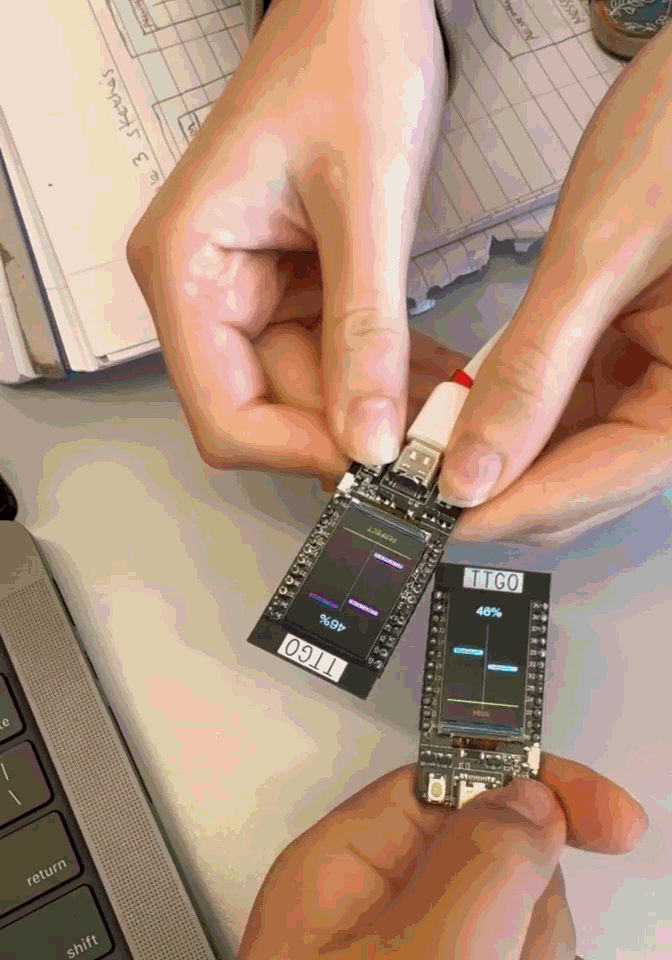

# Duet

## About
**Duet** description.

**[Blog Post](tbd)**

---

## Demo

  

[Video of full game](tbd)

## Design Goals
- Create a Piano Tiles-inspired experience using falling musical notes
- Assign each player a distinct set of notes and physical button controls
- Synchronize gameplay between two ESP32 devices using ESP-NOW wireless communication
- Detect and evaluate button presses based on note timing
- Provide immediate visual feedback for accurate hits, missed notes, and incorrect presses
- Combine both players' performance into a shared team accuracy score
- Display a collective performance rating at the end of each song
- Encourage rhythm, communication, and coordination between players

---

## Installation & Reproduction

### Hardware
- ESP32 TTGO T-Display x2
- USB-C cable x2
- Computer running Arduino IDE and Processing IDE x2
  
### Software
- Arduino IDE
- Processing IDE

### Running the Project
1) **Configure the Arduino sketches**
Open duet.ino in Arduino IDE. Make sure both boards use the same TEAM_ID and have different PLAYER_ID values:
Player 1: PLAYER_ID 0 (Piano)
Player 2: PLAYER_ID 1 (Vibraphone)
2) **Upload duet.ino to both LILYGO TTGO T-Display boards**
Player 1 should be connected to the computer running Processing during gameplay.
3) **Configure the Processing sketch**
Open the Processing project and update PORT_NAME to match the serial port of Player 1's ESP32. Make sure the baud rate is set to 115200.
4) **Prepare the MIDI file**
Make sure twinkle_twinkle.mid is located in the Processing project's data folder.
5) **Run the Processing sketch**
Launch the Processing application on the host computer. Both ESP32 boards should appear online once they establish communication.
6) **Play the game**
Press the spacebar on the host computer to begin. Each player uses the two physical buttons on their ESP32 to hit the falling notes in their respective lanes. Work together to achieve the highest possible team accuracy. Press the spacebar on the host computer to start another round.

